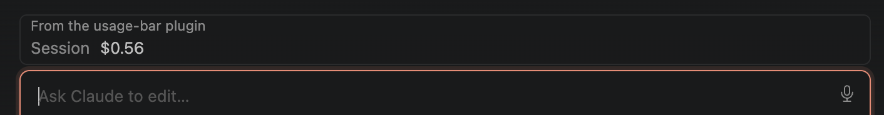

# usage-bar

A [Claude Code](https://claude.com/claude-code) mod that shows your usage limits, how full the context window is, and a one-click **Compact** button in a slim band above the prompt.


```
Session  ████░░░░░░ 35% resets 40m    Week     ███████░░░ 72% resets 1d 20h
Context  █████████░ 87% [ Compact ]
```

- **First row:** your plan's limits with reset countdowns: Session and Week, or Spend behind a gateway. On a usage-billed account, this session's estimated cost instead.
- **Second row:** how full the context window is, and **Compact**, which runs `/compact` and shows *Compacting…* until it finishes.
- Bars turn yellow at 60% and red at 80%.
- Updates after each turn, and the countdowns refresh every minute.
- On a narrow window, items move onto extra rows instead of getting cut off.
- Reads the same figures as `/usage`, `/context` and `/cost`.



## What it shows

| Account | First row | Second row |
| --- | --- | --- |
| Pro or Max | Session and Week bars | Context and Compact |
| Behind a Claude gateway with a spend limit | Spend bar | Context and Compact |
| API key, Console, or Team/Enterprise usage-based seat | This session's cost, such as `~$2.45` | Context and Compact |

- The cost is Claude Code's own estimate, the figure `/cost` prints, not your bill. It appears once the session has cost something.
- Context appears after the first reply, once Claude Code has measured it.

## Requirements

- Claude Code **2.1.326 or later** (update the desktop app if needed)
- It draws in the **Code tab** of the desktop app and in the terminal. It does not appear in regular chats or Cowork.

## Install

**Desktop app:** click **+** next to the prompt box, then **Plugins**, **Add marketplace**, enter `rabbit-ninja/usage-bar`, then **Add plugin** and choose `usage-bar`.

**Terminal:** at the prompt of a Claude Code session:

```
/plugin install usage-bar --marketplace rabbit-ninja/usage-bar
```

Answer `y` to add the marketplace, then pick a scope (user scope loads it in every session).

Start a new session and send a message. The band fills in after the first reply, once your usage figures arrive. If it doesn't appear, run `/reload-plugins`.

## Update

Once a session, the band checks GitHub for a newer release. When there is one, a green **↑ v…** button appears next to Compact; press it for the steps. Update under **+ → Plugins → Manage plugins**, or run `/plugin` in a terminal. You can also turn on auto-update for the `rabbit-ninja/usage-bar` marketplace there.

## Turn it off

Disable or uninstall it under **+ → Plugins → Manage plugins**, or run `/plugin` and open the **Installed** tab.

## Safety

Mods run code with your permissions. This one is small and readable: see [`hooks/register.tsx`](hooks/register.tsx). It reads usage, context and cost figures, draws text, and compacts the conversation only when you press Compact. Its one network request, once per session, reads this repository's [`plugin.json`](.claude-plugin/plugin.json) from GitHub to see whether a newer version exists. Nothing about you or your usage is sent.

## Development

Run the tests and checks with the Claude Code CLI:

```
claude plugin test .
claude plugin validate .
```

## License

MIT
