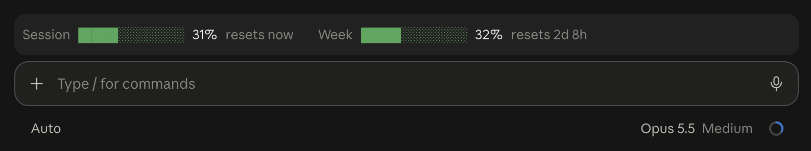

# usage-bar

A [Claude Code](https://claude.com/claude-code) mod that shows your **5-hour session** and **weekly** usage limits in a slim band above the prompt, with reset countdowns.



- Bars turn yellow at 60% and red at 80%.
- Updates after each turn, and the countdowns refresh every minute.
- Reads the same usage data as `/usage`. No network calls of its own, no data leaves your machine.


- Shows session usage cost.

## Requirements

- Claude Code **2.1.286 or later** (update the desktop app if needed)
- What it shows depends on the account:
  - **Pro or Max:** session and weekly bars.
  - **Behind a Claude gateway with a spend limit:** a spend bar.
  - **API key, Console, or Team/Enterprise usage-based seat:** no plan limits are reported, so it shows this session's cost (as `/cost` totals it).
- It draws in the **Code tab** of the desktop app and in the terminal. It does not appear in regular chats or Cowork.

## Install

**Desktop app:** click **+** next to the prompt box, then **Plugins**, **Add marketplace**, enter `rabbit-ninja/usage-bar`, then **Add plugin** and choose `usage-bar`.

**Terminal:** at the prompt of a Claude Code session:

```
/plugin install usage-bar --marketplace rabbit-ninja/usage-bar
```

Answer `y` to add the marketplace, then pick a scope (user scope loads it in every session).

Start a new session and send a message. The band appears after the first reply, once your usage figures arrive. If it doesn't, run `/reload-plugins`.

## Turn it off

Disable or uninstall it under **+ → Plugins → Manage plugins**, or run `/plugin` and open the **Installed** tab.

## Safety

Mods run code with your permissions. This one is small and readable: see [`hooks/register.tsx`](hooks/register.tsx). It only reads usage and cost figures and draws text.

## License

MIT
